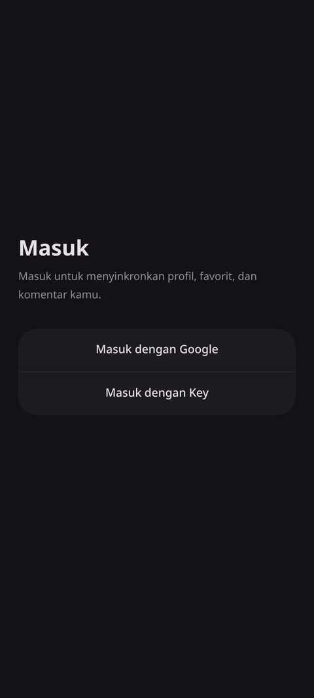
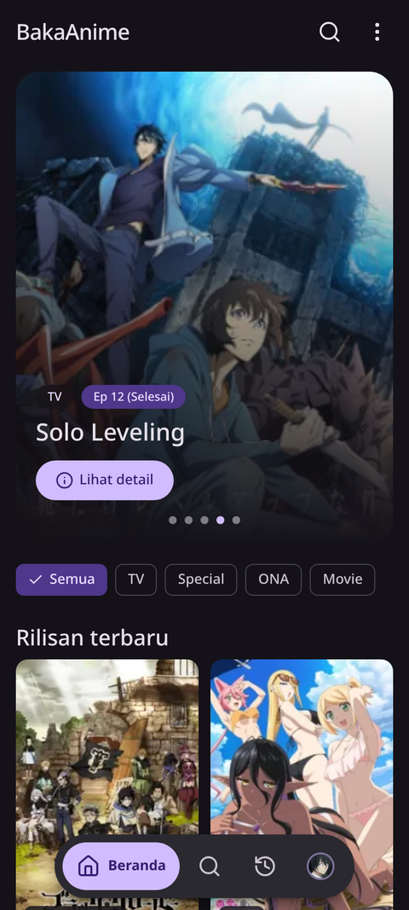
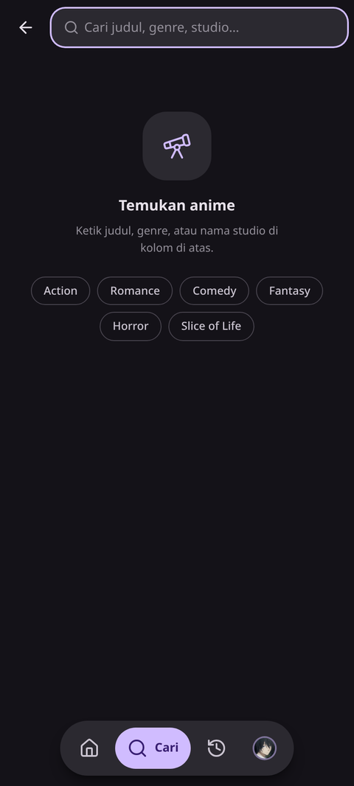
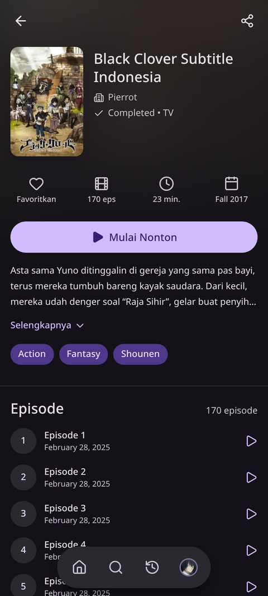
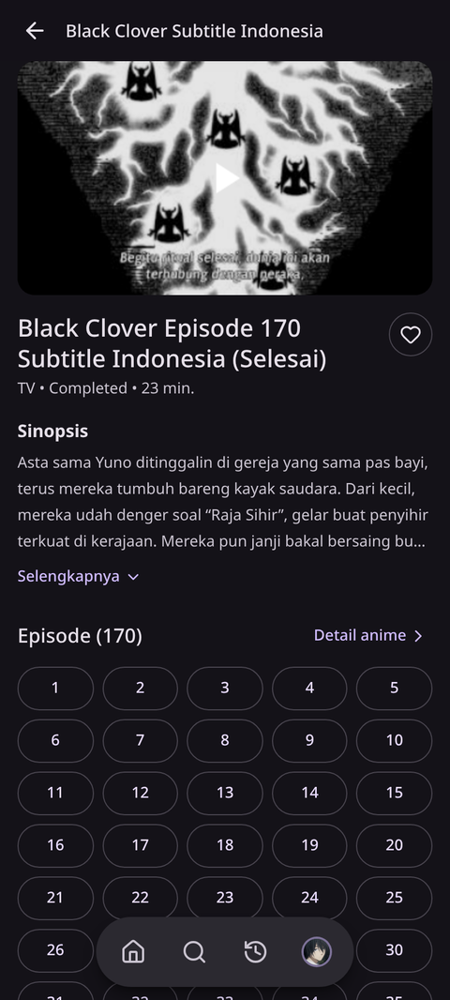
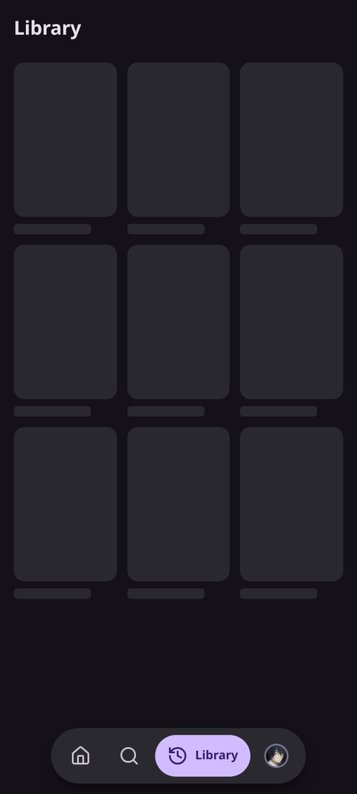
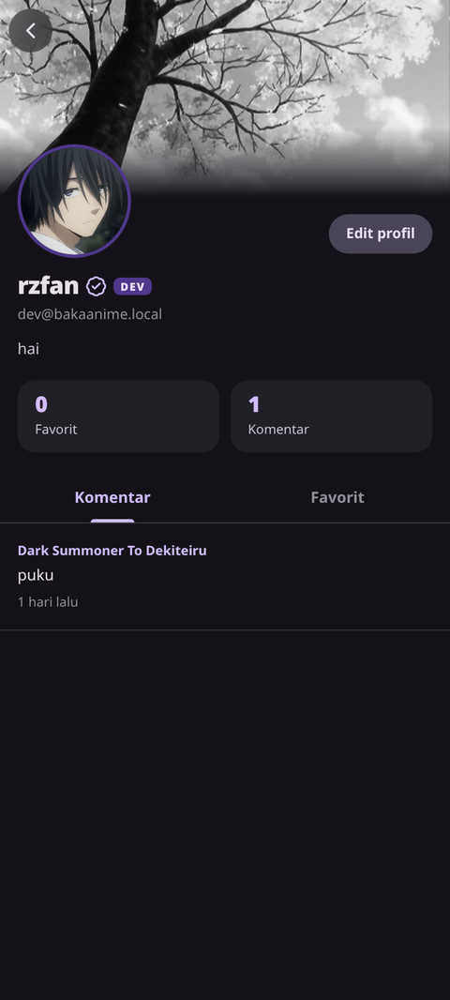
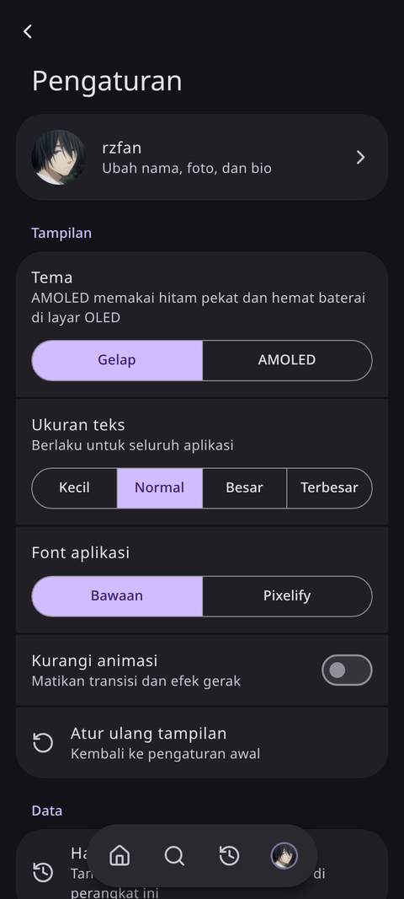
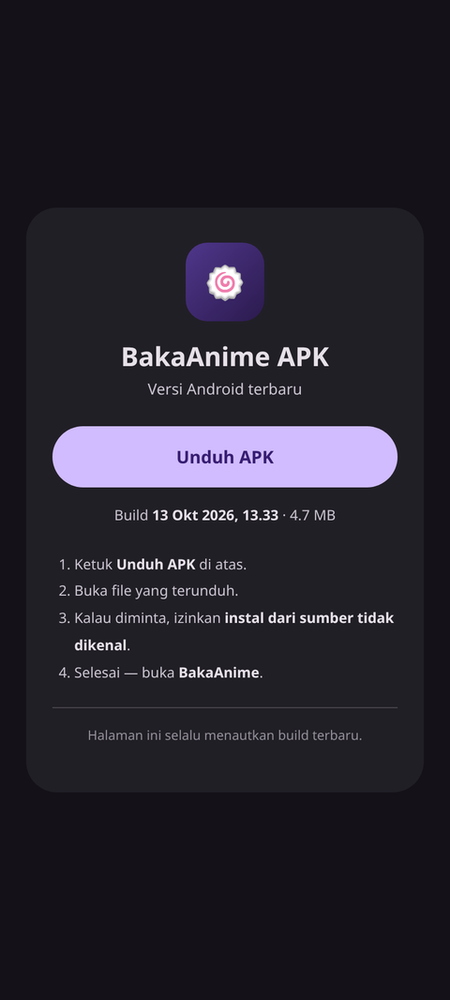

# BakaAnime

A mobile-first anime streaming browser with accounts, favorites, a watch
library, per-anime comments, and an Android app. Built with React + Vite on the
frontend, Vercel Serverless Functions + Neon Postgres on the backend, Clerk for
authentication, and Capacitor for the Android build.

<p align="center">
  
  
  
</p>
<p align="center">
  
  
  
</p>
<p align="center">
  
  
  
</p>

## Features

- **Accounts** — sign in with Google via Clerk (web and native Android), plus an
  optional key-based login for developer/verified accounts.
- **Discovery** — home feed, keyword search, and genre browsing.
- **Anime detail** — synopsis, metadata, and the full episode list.
- **Watch** — episode streaming with a server picker and download links.
- **Library & favorites** — save anime and pin up to three favorites to your profile.
- **Comments** — one thread per anime, tied to the signed-in user.
- **Profile & settings** — display name, avatar/banner, bio, custom username
  font (admin/dev), dark/AMOLED theme, and text size.
- **Android app** — Capacitor build with a rolling release, deep-link OAuth, and
  a public download page.

## Tech stack

| Layer      | Technology                                                            |
| ---------- | --------------------------------------------------------------------- |
| Frontend   | React 19, Vite, React Router, Tailwind CSS v4, Swiper, lucide-react    |
| Backend    | Vercel Serverless Functions (`api/`), Neon Postgres (`@neondatabase/serverless`) |
| Auth       | Clerk (`@clerk/react`, `@clerk/backend`, `@clerk/clerk-js`) + JWT (`jose`) |
| Anime data | Third-party public API (`sankavollerei.web.id` / AnimeKuIndo)          |
| Mobile     | Capacitor 8 (Android)                                                  |
| Tooling    | TypeScript, oxlint, GitHub Actions                                     |

## Architecture

```
Browser / Android WebView (React SPA)
  │  anime data (axios)         → third-party anime API (client-side)
  │  auth, profile, comments…   → /api/*  (same-origin Vercel Functions)
  ▼
Vercel Serverless Functions (api/)
  ├─ auth/clerk.ts   exchange a Clerk session token for our JWT
  ├─ auth/key.ts     legacy key login
  ├─ me.ts           current user
  ├─ profile.ts      update name / bio / avatar / banner / font
  ├─ favorites.ts    list, add, remove favorites
  ├─ library.ts      saved anime
  ├─ watched.ts      watch history
  ├─ comments.ts     per-anime comments
  ├─ img.ts          image proxy (allowlisted hosts)
  └─ clerk-proxy.ts  Clerk Frontend API proxy for /__clerk/*
  ▼
Neon Postgres (users, favorites, library, watched, comments, dev_keys)
```

- The frontend talks to its own backend through `/api`. In production that is
  same-origin; in local development set `VITE_API_URL` (see below).
- Anime metadata and streams come from a **third-party public API** and
  third-party embeds. See [Anime data source](#anime-data-source).
- Accounts are unified by a 30-day JWT signed with `AUTH_SECRET`; the token is
  stored in `localStorage` and sent as `Authorization: Bearer <token>`.

## Project structure

```
api/                 Vercel Serverless Functions
  _lib/              shared helpers: db, auth, http
  auth/              clerk.ts, key.ts
src/
  components/        Button, Comments, Navigation, Poster, SplashScreen, …
  lib/
    api/             backend.ts (our API), anime.ts (third-party API)
    clerk/           native.tsx, sso.ts (Android/SSO)
    auth.tsx, favorites.ts, image.ts, poster.ts, settings.ts, storage.ts
  pages/             Login, Home, Search, Detail, Watch, Library, Profile, Settings
  types/             shared TypeScript types
public/              download.html, favicon, splash assets
scripts/genkey.mjs   generate a dev/login key
android/             Capacitor Android project
schema.sql           Postgres schema
docs/screenshots/    README screenshots
```

## Anime data source

Anime metadata, episodes, and streams are fetched from the public API at
`https://www.sankavollerei.web.id/anime/animekuindo`, and playback is embedded
from third parties. This project **does not host or own any video content** and
only proxies/aggregates publicly available endpoints. If that upstream changes
or disappears, the browse/watch features will break until
`src/lib/api/anime.ts` is pointed at another source.

## Prerequisites

- Node.js 22+
- A [Neon](https://neon.tech) Postgres database
- A [Clerk](https://clerk.com) application (Google social connection enabled)
- [Vercel CLI](https://vercel.com/docs/cli) (`npm i -g vercel`) for full-stack dev
- For the Android build: JDK 21, Android SDK (platform 36, build-tools 36.0.0)

## Environment variables

Copy `.env.example` to `.env` and fill it in.

**Server (Vercel Functions):**

| Variable                | Required | Description                                                        |
| ----------------------- | -------- | ------------------------------------------------------------------ |
| `DATABASE_URL`          | yes      | Neon Postgres connection string (`?sslmode=require`).              |
| `AUTH_SECRET`           | yes      | Random string that signs the session JWT (`openssl rand -hex 32`). |
| `CLERK_SECRET_KEY`      | yes      | Clerk secret key (`sk_test_…` / `sk_live_…`).                      |
| `CLERK_PUBLISHABLE_KEY` | yes      | Clerk publishable key, used by the `/__clerk` proxy.               |
| `CLERK_FAPI_URL`        | no       | Override the Clerk Frontend API host used by the proxy.            |
| `DEV_ACCESS_KEY`        | no       | Legacy key that logs in as a verified dev account.                 |

**Client (Vite, bundled into the browser):**

| Variable                    | Required | Description                                                             |
| --------------------------- | -------- | ----------------------------------------------------------------------- |
| `VITE_CLERK_PUBLISHABLE_KEY`| yes      | Clerk publishable key (`pk_test_…` / `pk_live_…`).                       |
| `VITE_API_URL`              | no       | API base URL. Leave empty in production (same-origin `/api`).           |

> Local dev: `vercel dev` serves the frontend and functions on the same origin,
> so leave `VITE_API_URL` empty. If you run `npm run dev` (Vite only), set
> `VITE_API_URL=http://localhost:3000/api`.

## Local development

```bash
npm install
cp .env.example .env   # fill in the values
vercel dev             # frontend + serverless functions on http://localhost:3000
```

Alternatively run the Vite server alone:

```bash
npm run dev            # http://localhost:5173, needs VITE_API_URL pointed at the API
```

## Database setup

Create the tables from the schema:

```bash
psql "$DATABASE_URL" -f schema.sql
```

Tables: `users`, `favorites`, `library`, `watched`, `comments`, `dev_keys`.

To mint a dev/login key (stored hashed in `dev_keys`):

```bash
npm run genkey -- "My dev key" dev     # role: user | dev | admin
```

## Authentication

### Clerk (web + native Google)

1. Create a Clerk application and enable the **Google** social connection.
2. Copy the publishable key and secret key into your environment.
3. The frontend signs in with Clerk, then calls `POST /api/auth/clerk` to
   exchange the Clerk session token for this app's JWT.

`*.vercel.app` domains cannot CNAME to Clerk, so the browser reaches Clerk's
Frontend API through a same-origin proxy: `vercel.json` rewrites `/__clerk/*`
to `api/clerk-proxy.ts`, which forwards to Clerk using
`@clerk/backend/proxy`.

### Native Google (Android)

The APK loads the app from `https://app.bakaanime-v5.vercel.app` (a subdomain of
the web domain) and opens Google OAuth in the system browser, returning via a
custom deep link:

- Redirect: `com.bakaanime.app://sso-callback` (`src/lib/clerk/sso.ts`)
- Registered in `android/app/src/main/AndroidManifest.xml`
- `server.hostname` and `CapacitorHttp` are configured in `capacitor.config.ts`

Add `com.bakaanime.app://sso-callback` to the allowed redirect URLs in the Clerk
dashboard.

## Build

### Web

```bash
npm run build          # tsc -b && vite build  → dist/
npm run preview        # preview the production build
```

### Android APK

The APK is built in CI (`.github/workflows/build-apk.yml`) on every push to
`main`. It builds the web bundle, runs `cap sync`, builds a signed release APK,
and publishes it to a rolling `latest` GitHub Release. The public
`/download.html` page links to that release and always serves the newest build.

The version is derived from the workflow run number (`1.0.<run_number>`).

Required GitHub Actions configuration:

- **Variables:** `VITE_API_URL`, `VITE_CLERK_PUBLISHABLE_KEY`
- **Secrets:** `KEYSTORE_BASE64`, `KEYSTORE_PASSWORD`, `KEY_ALIAS`, `KEY_PASSWORD`

To build locally (needs JDK 21 + Android SDK):

```bash
npm run build
npm run cap:sync
npm run cap:run        # or open android/ in Android Studio
```

## Deployment

- **Web + API:** deploy to Vercel. Because `vercel.json`, `api/`, and
  `public/` affect routing, redeploy the project after changing them.
- **APK:** handled by GitHub Actions on push to `main` (see above).

## Fork / self-host checklist

When rebuilding your own instance, update the hard-coded references:

- `capacitor.config.ts` → `server.hostname` (your web domain).
- Clerk dashboard → allowed redirect URLs and the Google connection.
- `public/download.html` → GitHub repo path for the APK release.
- `api/_lib/http.ts` → `ORIGINS` allowlist (your web/APK origins).
- `.github/workflows/build-apk.yml` → GitHub Actions variables and secrets.
- `vercel.json` / domain → your own project and domain.

## Scripts

| Script             | Description                                        |
| ------------------ | -------------------------------------------------- |
| `npm run dev`      | Start the Vite dev server.                         |
| `npm run build`    | Type-check and build for production.               |
| `npm run preview`  | Preview the production build.                      |
| `npm run lint`     | Run oxlint.                                        |
| `npm run cap:sync` | Sync the web build into the Android project.       |
| `npm run cap:run`  | Build and run on a connected device/emulator.      |
| `npm run genkey`   | Create a dev/login key in `dev_keys`.              |

## License

Released under the [MIT License](LICENSE).
